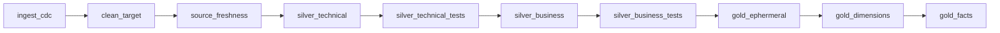

# Retail Lakehouse Orchestration: Airflow + dbt + Databricks

An end-to-end data engineering project on Walmart-style retail data. Changes from a Postgres-compatible database (via CDC) are ingested into Delta tables on Databricks by a PySpark job. dbt then transforms the data through silver and gold layers, with source freshness checks and tests as quality gates, and Apache Airflow orchestrates the whole flow in Docker.

## Architecture


## Table of contents

- [Highlights](#highlights)
- [Architecture overview](#architecture-overview)
- [Pipeline: the `orchestrate` DAG](#pipeline-the-orchestrate-dag)
- [Tech stack](#tech-stack)
- [Data model](#data-model)
- [Project structure](#project-structure)
- [Getting started](#getting-started)
- [Loading the raw data](#loading-the-raw-data)
- [Running the pipeline](#running-the-pipeline)
- [Development troubleshooting](#development-troubleshooting)
- [Docker services](#docker-services)
- [Configuration reference](#configuration-reference)
- [Scope and status](#scope-and-status)
- [Known limitations and roadmap](#known-limitations-and-roadmap)

## Highlights

- **CDC-based ingestion.** A PySpark job on Databricks reads changes from the operational database and applies upserts to a bronze Delta table.
- **Lakehouse storage.** Databricks on Apache Spark with Delta Lake (ACID transactions, upserts, time travel).
- **Layered dbt transformations.** Silver technical, silver business, then gold (reusable building-block models, dimension snapshots and fact models).
- **Quality gates.** dbt source freshness runs first, and dbt tests run after each silver layer. A failing step stops the DAG before gold is built.
- **Dimension history.** Gold dimensions are built with `dbt snapshot`, which keeps history of changing attributes.
- **Orchestrated and reproducible.** Apache Airflow 3.2 with CeleryExecutor, Redis and PostgreSQL, started with Docker Compose. dbt and the Databricks adapter are baked into the same image.
- **Modern developer workflow.** VS Code connected to the database server over MCP, with database forks for safe experimentation.

## Architecture overview

```
 Ghost (Postgres-compatible DB) --CDC--> Bronze (Delta)  -->  Silver  -->  Gold
                                         PySpark upserts       technical     building-block models
                                         (Databricks Job)      business      dimensions (snapshots)
                                                                             facts

 Orchestration: Apache Airflow (Docker, CeleryExecutor)     Transformations: dbt Core + dbt-databricks
```

1. **Sources.** A Postgres-compatible operational database (Ghost) emits changes through CDC. The six source entities are also available as CSV files, which `load_data.py` loads into a `raw` schema (see [Loading the raw data](#loading-the-raw-data)).
2. **Bronze.** A PySpark job on Databricks (run as a Databricks Job) applies the CDC changes as upserts into a bronze Delta table.
3. **Silver.** dbt cleans and types the data (silver technical), then applies business rules (silver business). Each step is followed by dbt tests.
4. **Gold.** dbt builds the gold building-block models, then dimension tables with `dbt snapshot`, then fact tables, giving a star schema for BI and reporting.
5. **Orchestrate.** One Airflow DAG runs every step in order.

## Pipeline: the `orchestrate` DAG

The DAG lives in `dags/orchestrate.py` and is built with the Airflow 3 SDK (`from airflow.sdk import dag, task`).



| # | Task | Type | What it runs |
|---|---|---|---|
| 1 | `ingest_cdc` | `@task` (Python) | Triggers a Databricks Job with the Databricks SDK (`WorkspaceClient.jobs.run_now`), polls `get_run` every 5 seconds, and fails the task unless the result is `SUCCESS` |
| 2 | `clean_target` | `@task.bash` | `rm -rf` of the dbt `target` and `logs` folders |
| 3 | `source_freshness` | `@task.bash` | `dbt source freshness` |
| 4 | `silver_technical` | `BashOperator` | `dbt run --select silver_t` |
| 5 | `silver_technical_tests` | `BashOperator` | `dbt test --select silver_t` |
| 6 | `silver_business` | `BashOperator` | `dbt run --select silver_b` |
| 7 | `silver_business_tests` | `BashOperator` | `dbt test --select silver_b` |
| 8 | `gold_ephermeral` | `BashOperator` | `dbt run --select gold/ephermeral` |
| 9 | `gold_dimensions` | `BashOperator` | `dbt snapshot` |
| 10 | `gold_facts` | `BashOperator` | `dbt run --select gold/fact` |

The dbt tasks run inside the Airflow containers from `/opt/airflow/walmart_project`, the dbt project mounted by Docker Compose. The tasks run strictly one after another, so a failure stops everything downstream.

> **Note on naming:** the folder, selector and task id are spelled `ephermeral`. Keep them consistent, or rename all three to `ephemeral` together (see the roadmap).

## Tech stack

| Area | Technology |
|---|---|
| Orchestration | Apache Airflow 3.2 (CeleryExecutor) |
| Message broker | Redis 7.2 |
| Airflow metadata DB | PostgreSQL 16 |
| Containers | Docker, Docker Compose |
| Transformation | dbt Core (`dbt-core`), `dbt-databricks` adapter |
| Compute and storage | Databricks, Apache Spark, Delta Lake |
| Databricks automation | Databricks SDK for Python (`databricks-sdk`) |
| Ingestion | CDC, PySpark |
| Source database | Ghost (Postgres-compatible) |
| Languages | Python, SQL |
| Tooling | VS Code, Git, MCP (Model Context Protocol) |

## Data model

Six source entities are loaded into the `raw` schema:

| Table | Description |
|---|---|
| `raw.customers` | Customer reference data |
| `raw.stores` | Store reference data |
| `raw.products` | Product catalogue |
| `raw.employees` | Employee reference data |
| `raw.orders` | One row per order |
| `raw.order_items` | One row per order line (the natural fact-table grain) |

The gold layer is a dimensional model: fact tables built with `dbt run` and dimension tables built with `dbt snapshot` so changes over time are preserved.

`raw.*` refers to the source-side tables populated by `load_data.py`. The Databricks CDC job separately consumes changes from the Ghost operational database and writes them to Bronze Delta tables. The raw schema and the Bronze layer are distinct representations, not two names for the same tables.

## Project structure

```
.
├── dags/
│   └── orchestrate.py    # The Airflow DAG
├── docs/
│   └── development-troubleshooting.md  # Common development errors (also summarised below)
├── walmart_project/      # dbt project (mounted into the Airflow containers)
├── config/               # Airflow configuration (generated airflow.cfg; contains keys, do not commit)
├── plugins/              # Airflow plugins
├── logs/                 # Airflow logs
├── data/                 # Source CSV files
├── ddl/                  # DDL for the raw tables
├── assets/               # README images
├── load_data.py          # Bulk-loads CSVs into the raw schema
├── Dockerfile            # Custom Airflow image (adds gcc, dbt, dependencies)
├── docker-compose.yaml   # Full Airflow stack
├── requirements.txt      # Python dependencies
└── .env                  # Local environment variables (do not commit)
```

## Getting started

### Prerequisites

- Docker and Docker Compose v2
- At least 4 GB of RAM and 2 CPUs available to Docker, and about 10 GB of free disk space
- A Databricks workspace with a SQL warehouse or cluster for dbt, and a Databricks Job that runs the CDC ingestion
- Python 3.9+ (only needed to run `load_data.py` locally)

### 1. Clone the repository

```bash
git clone https://github.com/pr4navvvv/retail-lakehouse-orchestration.git
cd retail-lakehouse-orchestration
```

### 2. Create the `.env` file

```bash
AIRFLOW_UID=50000
FERNET_KEY=<generate-one-below>
```

Generate a Fernet key:

```bash
python -c "from cryptography.fernet import Fernet; print(Fernet.generate_key().decode())"
```

> `.env` holds secrets. Keep it out of version control. The generated `config/airflow.cfg` also contains a Fernet key and an API secret key, so keep it out of Git too. Suggested `.gitignore` entries:
>
> ```
> .env
> airflow.cfg
> config/airflow.cfg
> logs/
> walmart_project/target/
> walmart_project/logs/
> ```
>
> Confirm the rules are active with `git check-ignore -v .env config/airflow.cfg` (and `airflow.cfg` if a root-level file exists). A `.gitignore` rule does not untrack a file already committed; if a secrets-bearing file was ever pushed, remove it from tracking and rotate the exposed keys.

### 3. Configure Databricks access

The `ingest_cdc` task needs three values: your workspace host, an access token and the ID of the Databricks Job that runs the CDC ingestion. In `dags/orchestrate.py` these appear as the placeholders `your_databricks_host`, `your_databricks_token` and `your_databricks_job_id`. Replace them locally only.

> **Never commit real tokens.** Prefer environment variables, an Airflow Connection or Variable, or a secrets backend over literals in the DAG file (see the roadmap). If a token was ever committed, revoke and replace it, because removing it from the latest commit does not remove it from Git history.

Also create a dbt profile (`profiles.yml`) for `walmart_project` using the `databricks` adapter, with your host, SQL warehouse HTTP path and token, supplied through environment variables.

### 4. Build and start Airflow

```bash
docker compose build
docker compose up airflow-init
docker compose up -d
```

Open the UI at <http://localhost:8080>. For a fresh local development environment, Compose may create the default `airflow` / `airflow` account. Change the credentials before exposing the UI beyond your machine; never reuse these defaults in a shared or production environment.

To also start the Celery monitoring UI (Flower, port 5555):

```bash
docker compose --profile flower up -d
```

## Loading the raw data

`load_data.py` bulk-loads the six CSV files from the local `data/` folder into the `raw` schema using `psycopg2` and PostgreSQL `COPY`. It reads local files; it does not connect to cloud storage. Tables are loaded parents first (customers, stores, products, employees), then orders and order items.

1. Create the raw tables using the scripts in `ddl/`.
2. Put the CSV files in `data/`.
3. Set `conn_string` in `load_data.py` to your database connection string (keep it out of Git).
4. Run:

```bash
pip install psycopg2-binary
python load_data.py
```

> Re-running the script appends rows again. Truncate the tables first if you need a clean reload.

## Running the pipeline

1. In the Airflow UI, find the `orchestrate` DAG and unpause it (DAGs are paused at creation).
2. Trigger a run. The DAG code does not set a schedule, so runs are started manually unless you add one.
3. Follow progress in the Grid and Graph views and the task logs.

Useful commands:

```bash
docker compose ps                                  # service status
docker compose logs -f airflow-worker              # follow worker logs
docker compose exec airflow-scheduler airflow dags list-import-errors
docker compose down                                # stop the stack
docker compose down -v                             # stop and delete the metadata database volume
```

## Development troubleshooting

The DAG processor writes parse logs to the `logs/` folder. Each DAG file is re-parsed at least every 30 seconds (`min_file_process_interval`). If a DAG does not appear in the UI, check for import errors:

```bash
docker compose exec airflow-scheduler airflow dags list-import-errors
docker compose logs --tail=100 airflow-dag-processor
```

### DAG parsing errors

| Error | Cause | Fix |
|---|---|---|
| `TypeError: 'BashOperator' object is not callable` | A classic operator instance was called like a function in the dependency chain. | Call only `@task` functions with parentheses. Reference `BashOperator` objects without them, for example `silver_technical >> silver_technical_tests`. |
| `NameError: name 'ws' is not defined` | The Databricks client variable was used outside its scope. | Create the `WorkspaceClient` inside the `ingest_cdc` task. |
| `NameError: name '...' is not defined` for a task | A task was referenced before it was defined. | Define every task before wiring dependencies. |
| Deprecation warning for `airflow.operators.bash.BashOperator` | Old import path. | Import from `airflow.providers.standard.operators.bash`. |

### Runtime checks

| Symptom | Likely cause | Fix |
|---|---|---|
| `ingest_cdc` fails right away | Databricks host, token or job ID is still a placeholder. | Set real values (ideally through environment variables or an Airflow Connection) and re-run the task. |
| `ingest_cdc` fails after the job runs | The Databricks job ended in a non-`SUCCESS` state. | Open the run in the Databricks Jobs UI and read its logs. The task fails on purpose so nothing runs downstream. |
| A dbt task fails with a connection or auth error | `profiles.yml` is missing or has a wrong host, HTTP path or token. | Run `dbt debug` from `walmart_project` inside the worker container and fix the profile. |
| A dbt gold task selects nothing | The selector does not match the folder name. | Run `dbt ls --select gold/ephermeral` and check that the folder, selector and task id use the same spelling. |
| Files in `logs/` or `config/` are owned by root | `AIRFLOW_UID` is not set (Linux). | Set `AIRFLOW_UID=50000` in `.env`, then rebuild. |

### Resetting the local stack

```bash
docker compose down        # stop the stack
docker compose down -v     # stop and delete the metadata database volume
docker compose build
docker compose up airflow-init
docker compose up -d
```

`down -v` deletes DAG run history and any Airflow connections or variables stored in the metadata database.

## Docker services

| Service | Purpose |
|---|---|
| `postgres` | Airflow metadata database and Celery result backend |
| `redis` | Celery message broker |
| `airflow-apiserver` | UI, REST API and task execution API (port 8080) |
| `airflow-scheduler` | Schedules DAG runs and tasks |
| `airflow-dag-processor` | Parses DAG files |
| `airflow-worker` | Executes tasks (Celery worker) |
| `airflow-triggerer` | Runs deferrable tasks |
| `airflow-init` | One-off setup: DB migration, admin user, resource checks |
| `flower` (profile) | Celery monitoring UI (port 5555) |
| `airflow-cli` (profile `debug`) | Debug shell |

The `dags`, `logs`, `config`, `plugins` and `walmart_project` folders are mounted into `/opt/airflow/`, so code changes appear without rebuilding the image.

## Configuration reference

| Variable | Default | Purpose |
|---|---|---|
| `AIRFLOW_UID` | `50000` | User ID inside the containers (avoids root-owned files on Linux) |
| `FERNET_KEY` | none | Encrypts connections and variables in Airflow |
| `AIRFLOW__API_AUTH__JWT_SECRET` | Local-development placeholder only | Signs API tokens; set a unique, secret value outside isolated local development |
| `_AIRFLOW_WWW_USER_USERNAME` | `airflow` | Initial admin username |
| `_AIRFLOW_WWW_USER_PASSWORD` | `airflow` | Initial admin password |
| `AIRFLOW_PROJ_DIR` | `.` | Base path for mounted folders |

**Precedence:** environment variables named `AIRFLOW__SECTION__KEY` override `airflow.cfg`. The generated `airflow.cfg` shows Airflow defaults (`LocalExecutor`, SQLite, `SimpleAuthManager`), but `docker-compose.yaml` overrides them with `CeleryExecutor`, a PostgreSQL connection and the FAB auth manager, so the compose values are what run.

Other effective defaults worth knowing: `default_task_retries = 0` (no retries unless you set them), no default task timeout, DAG files re-parsed at least every 30 seconds (`min_file_process_interval`), a 30-second import timeout, Celery `worker_concurrency = 16` and `parallelism = 32`.

Python dependencies (`requirements.txt`): `airflow-operators`, `apache-airflow`, `dbt-core`, `dbt-databricks`. The DAG also imports `databricks.sdk`, which is expected to arrive through `dbt-databricks`; consider listing `databricks-sdk` explicitly.

## Scope and status

- **Implemented:** the ten-task `orchestrate` DAG, the Dockerised Airflow stack, CDC ingestion triggered through a Databricks Job, the silver and gold dbt stages with source freshness checks and tests after each silver layer, dbt snapshots for dimensions, and the CSV bulk loader.
- **Design intent:** a metadata-driven One Big Table (OBT), driven by a configuration template of table names, columns and join conditions, feeding the dimensional model. Its model name, materialization and position in the DAG are not yet documented here.
- **Local development only:** this stack is for local use and has not been hardened for production (see the roadmap).

## Known limitations and roadmap

- **Secrets:** verify `.env`, `airflow.cfg` and `config/airflow.cfg` are gitignored; define `FERNET_KEY` in `.env` (compose reads it, and the shared `.env` does not set it). Move the Databricks host, token and job ID out of the DAG code (for example into environment variables, which the Databricks SDK reads natively, or an Airflow Connection), and move the database connection string in `load_data.py` into an environment variable. Scan Git history for committed tokens and revoke any found.
- **Ingestion documentation:** document the CDC job's merge key, change tracking (offset or checkpoint) and delete handling.
- **Gold models:** document the materialization of the `ephermeral` building-block models. Ephemeral dbt models are compiled into downstream SQL rather than stored as tables, so confirm what task 8 produces.
- **Quality gates:** list the dbt tests per layer (not null, unique, relationships, accepted values) and the snapshotted dimensions with their strategy and unique keys.
- **One Big Table:** document the OBT model, its materialization, and where it sits in the DAG.
- **DAG hardening:** add a schedule, retries with a delay (the default is 0 retries), execution timeouts (none by default) and failure alerts. Replace the hand-written polling loop with the Databricks provider's `DatabricksRunNowOperator` (deferrable).
- **Imports:** switch to `airflow.providers.standard.operators.bash.BashOperator` to remove the deprecation warning.
- **dbt:** select snapshots explicitly instead of running `dbt snapshot` for everything, keep `target` and logs between runs if you want state-based runs, and consider `dbt build` per layer.
- **Naming:** rename `ephermeral` to `ephemeral` consistently across the dbt model folder, selector, Airflow task id and documentation; then validate the selector with `dbt ls` before running the DAG.
- **Versions:** align the Dockerfile base image (`apache/airflow:3.2.0`) with the `apache-airflow>=3.2.2` requirement, pin exact package versions, and verify with a clean `docker compose build --no-cache`.
- **Raw loads:** make `load_data.py` idempotent (truncate-and-load or upsert, single transaction) and fix error handling when the initial connection fails.
- **CI:** run `dbt build` and tests on every pull request, and lint the DAGs.
- **Governance and scale:** Unity Catalog, lineage and column-level docs; Kubernetes or managed Airflow instead of Docker Compose.

## Local use only

This Docker Compose configuration is meant for local development. Do not use it as-is in production.
